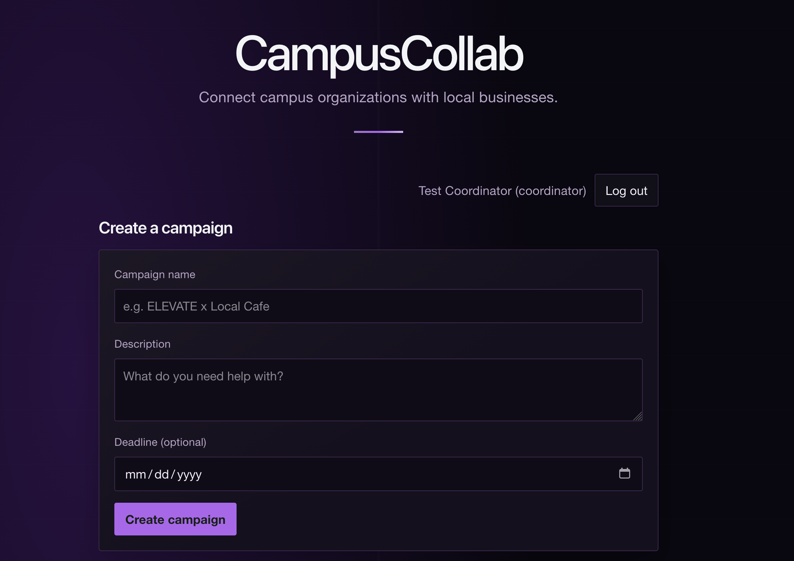
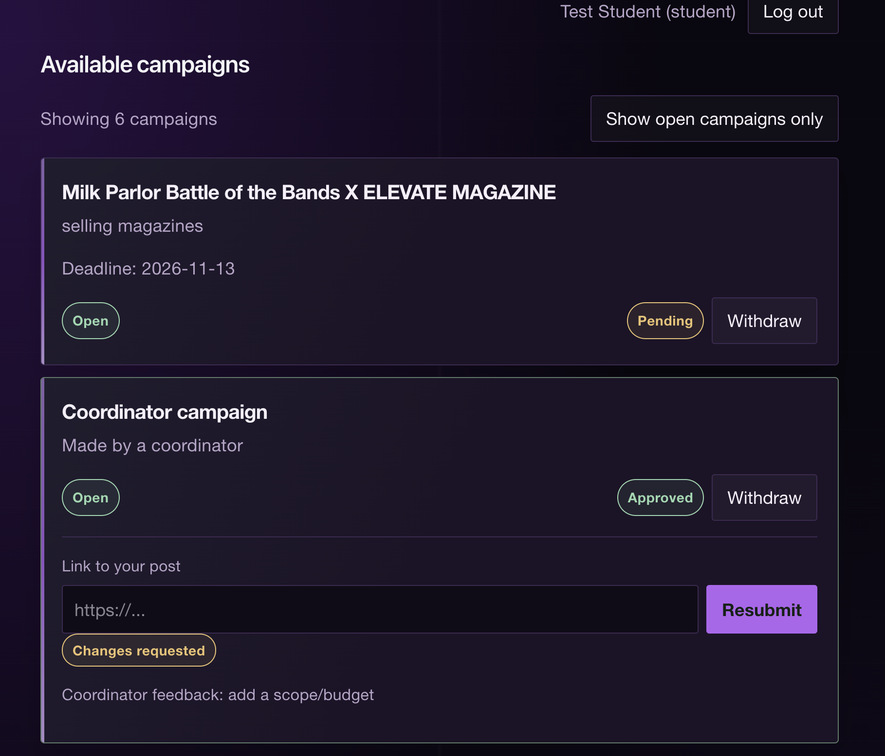
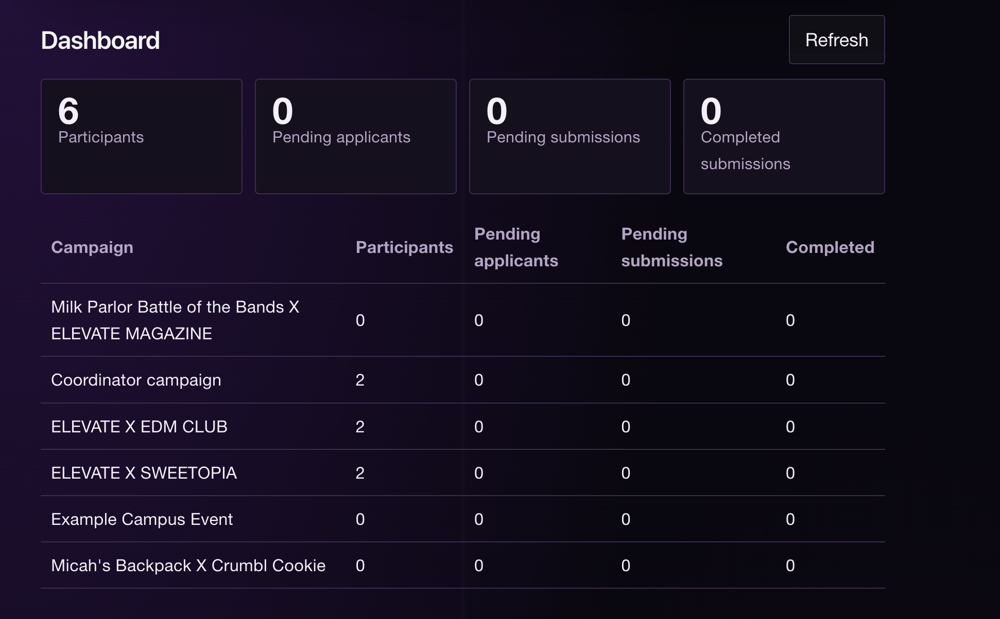

# CampusCollab

A full-stack web app that helps a campus organization run promotional campaigns with local businesses. Coordinators post campaigns, students apply and submit links to their content, and coordinators approve work or ask for changes.

I built it to practice the parts of web development that matter once real users are involved: authentication, role-based permissions enforced on the server, relational data modeling, and automated tests.

**Status:** working end to end on my machine, with 12 automated tests. Deployment is next.
**Live demo:** coming soon

## Screenshots

| Coordinator creates a campaign | Student view with reviewer feedback |
| --- | --- |
|  |  |



## What it does

**Coordinators** (campus organization leads)
- Create campaigns with a title, description, and optional deadline
- Review applicants and approve or reject them
- Review each student's submitted link: approve it, or request changes with written feedback
- See a dashboard with participants, pending applicants, pending submissions, and completed submissions, per campaign and in total

**Students**
- Browse campaigns and apply (or withdraw)
- After approval, submit a link to their post, and resubmit when changes are requested
- See the status of every application and submission

## Tech stack

| Layer | Tools |
| --- | --- |
| Frontend | React, TypeScript, Vite |
| Backend | Node.js, Express, TypeScript |
| Database | PostgreSQL (`pg`) |
| Auth | Server-side sessions (`express-session`, `connect-pg-simple`), Argon2id password hashing (`argon2`) |
| Tests | Vitest, Supertest |

## Data model

- `users`: name, email (unique), password hash, role (`student` or `coordinator`)
- `campaigns`: title, description, deadline, status, and `created_by` (the owning coordinator)
- `participations`: a student's application to a campaign (`Pending`, `Approved`, `Rejected`), with a unique constraint on `(campaign_id, user_id)`
- `submissions`: one content link per participation (`Submitted`, `Approved`, `ChangesRequested`) plus reviewer feedback
- `session`: login sessions, stored in PostgreSQL

## API overview

| Method and path | Who can call it |
| --- | --- |
| `POST /api/auth/signup`, `POST /api/auth/login`, `POST /api/auth/logout`, `GET /api/auth/me` | Anyone / logged-in user |
| `GET /api/campaigns` | Anyone |
| `POST /api/campaigns` | Coordinator |
| `POST` / `DELETE /api/campaigns/:id/apply` | Student |
| `GET /api/campaigns/:id/participants` | Coordinator who owns the campaign |
| `PATCH /api/participations/:id` | Coordinator who owns the campaign |
| `GET /api/me/participations`, `GET /api/me/submissions` | Logged-in user / student |
| `PUT /api/campaigns/:id/submission` | Student approved for that campaign |
| `GET /api/campaigns/:id/submissions` | Coordinator who owns the campaign |
| `PATCH /api/submissions/:id` | Coordinator who owns the campaign |
| `GET /api/dashboard` | Coordinator |

## Design decisions

- **Permissions live on the server, not in the UI.** Hiding a button is not security. A student cannot approve their own application or submission even by calling the API directly, and a coordinator can only act on campaigns they own. Ownership is checked inside the SQL query, and a failed check returns `404` so the API does not reveal which records exist.
- **Passwords are hashed with Argon2id**, and passwords are never stored or logged in plain text.
- **Sessions use an `httpOnly`, `SameSite=Lax` cookie**, and the session id is regenerated on login to prevent session fixation. Sessions are stored in PostgreSQL so they survive a server restart.
- **Coordinator sign-up requires an invite code**, so a random visitor cannot make themselves a coordinator.
- **The database enforces the rules too.** A unique constraint on `(campaign_id, user_id)` prevents duplicate applications even if a student double-clicks or sends two requests at once, and `CHECK` constraints limit roles and statuses to valid values.
- **All SQL is parameterized** to prevent SQL injection.
- **Only `http` and `https` links are accepted** for submissions, which rejects values like `javascript:` URLs.
- **Approved work is locked.** A student cannot change a submission after it has been approved.

## Running it locally

**Prerequisites:** Node.js 20+ and PostgreSQL 16

```bash
git clone https://github.com/iaku12/campuscollab.git
cd campuscollab
npm install
cd server && npm install && cd ..
```

Create the database and tables:

```bash
createdb campuscollab
psql campuscollab -f server/schema.sql
psql campuscollab -f server/migrations/002_users_and_participations.sql
psql campuscollab -f server/migrations/003_submissions.sql
```

Create `server/.env`:

```
DATABASE_URL=postgres://localhost:5432/campuscollab
PORT=3001
SESSION_SECRET=replace-with-a-long-random-string
COORDINATOR_INVITE_CODE=replace-with-a-code-coordinators-must-enter
```

You can generate a session secret with `openssl rand -hex 32`.

Start the API and the frontend in two terminals:

```bash
# Terminal 1 (API on http://localhost:3001)
cd server
npm run dev

# Terminal 2 (frontend on http://localhost:5173)
npm run dev
```

Open http://localhost:5173, sign up as a student, and sign up as a coordinator (using your invite code) in a second browser or private window to try the full workflow.

## Tests

The tests call the real API and run against a **separate test database**, so they never touch development data. They refuse to run unless `DATABASE_URL` ends up pointing at a `*_test` database.

```bash
createdb campuscollab_test
psql campuscollab_test -f server/schema.sql
psql campuscollab_test -f server/migrations/002_users_and_participations.sql
psql campuscollab_test -f server/migrations/003_submissions.sql

cd server
npm test
```

The 12 tests cover:
- Who can create campaigns (anonymous users, students, and coordinators without the invite code)
- A student cannot approve their own application
- A coordinator cannot approve applicants on someone else's campaign
- Duplicate applications and applications to closed campaigns are rejected
- Unapproved students cannot submit, and unsafe links are rejected
- The full review workflow: submit, request changes, resubmit, approve, lock
- Dashboard counts, and dashboard access control

## Known limitations and next steps

- Not deployed yet (frontend, API, and hosted PostgreSQL)
- No password reset or email verification
- Coordinator access is gated by an invite code, not by verifying the organization
- No rate limiting on login attempts
- Campaign lists are not paginated, and the dashboard refreshes manually
- Planned: GitHub Actions to run the tests on every push, and a short list of improvements based on feedback from real users
